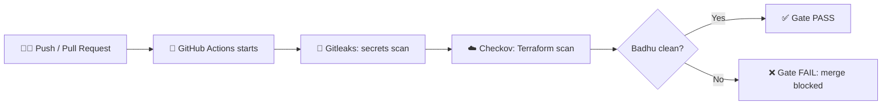

# 🛡️ DevSecOps CI/CD Security Gate


> 🔐 Aa project ek **GitHub Actions "security gate"** che: darek **push** ane **pull request** par te **hardcoded secrets** ane **Terraform misconfigurations** check kare che. Jo koi problem male to workflow **fail** thay che ane **merge / deploy rokay che** 🚫. Aane **shift-left security** kahe che.

> ⚠️ **Note:** Aa ek learning / lab project che. Badha credentials **fakt fake / dummy** che. Real API key, token ke password kyarey commit karvo nahi.

---

## 📑 Table of Contents

1. [🎯 Project Overview](#-project-overview)
2. [🧰 Tools Used](#-tools-used)
3. [🔄 Pipeline Flow](#-pipeline-flow)
4. [📁 Repository Structure](#-repository-structure)
5. [✅ Prerequisites](#-prerequisites)
6. [🚀 Step 1: Repo ane insecure files](#-step-1-repo-ane-insecure-files)
7. [⚙️ Step 2: Security workflow](#️-step-2-security-workflow)
8. [🔴 Step 3: Pipeline trigger ane findings](#-step-3-pipeline-trigger-ane-findings)
9. [🛠️ Step 4: Remediation](#️-step-4-remediation-fix-karo)
10. [🟢 Step 5: Re-verify](#-step-5-re-verify)
11. [📸 Screenshots / Evidence](#-screenshots--evidence)
12. [🐞 Common Errors ane Fixes](#-common-errors-ane-fixes)
13. [🧹 Cleanup](#-cleanup)
14. [🎓 Viva / Report Summary](#-viva--report-summary)
15. [💡 Key Learnings](#-key-learnings)

---

## 🎯 Project Overview

Modern software development ma **security** ne chhella step par nahi, **shuruat thi j** (left side) lavvi joiye. Aa project e te idea ne practically batave che:

- 👨‍💻 Developer code **push** kare ke **pull request** banave
- 🤖 GitHub Actions automatic security scan chalave
- 🔑 **Gitleaks** code ma hardcoded secrets shodhe
- ☁️ **Checkov** Terraform (Infrastructure as Code) ma misconfigurations shodhe
- ❌ Problem male to **gate fail** → merge block
- ✅ Badhu clean hoy to **gate pass**

Aa project ma pehla **jaanbujhine insecure code** mukyo (pipeline **fail**), pachhi badhi problems **fix** kari (pipeline **pass**).

---

## 🧰 Tools Used

| 🧩 Tool | 🔍 Shu check kare che |
|---|---|
|  **GitHub Actions** | Pipeline chalave (push / pull request par) |
| 🔑 **Gitleaks** | Code ma hardcoded secrets (API key, token, password) |
| ☁️ **Checkov** | Terraform (IaC) ma security mistakes (open SSH, unencrypted S3 vagere) |
| 🏗️ **Terraform** | AWS infrastructure (S3 bucket, Security Group, KMS) define kare che |
| 🐍 **Python** | Sample `config.py` (secret handling batavva mate) |

---

## 🔄 Pipeline Flow



1. 👨‍💻 Developer code push kare ke pull request banave
2. 🤖 GitHub Actions workflow start thay
3. 🔑 Gitleaks secrets scan kare
4. ☁️ Checkov Terraform scan kare
5. ✅ Badhu clean hoy to gate **pass**, nahi to ❌ **fail** ane merge block

---

## 📁 Repository Structure

```text
devsecops-cicd-gatekeeper/
├── .github/
│   └── workflows/
│       └── security-gate.yml   # 🤖 GitHub Actions security gate
├── main.tf                     # ☁️ Terraform (pehla insecure, pachhi secure)
├── config.py                   # 🐍 Fake API key (pachhi env variable)
└── README.md                   # 📖 Aa file
```

---

## ✅ Prerequisites

- 🐙 GitHub account
- 💻 (Optional) **Git** installed: <https://git-scm.com/download/win> → check: `git --version`
- 🪟 (Optional) Windows PowerShell
- 🧠 Basic samaj: Git, YAML, Terraform

---

## 🚀 Step 1: Repo ane insecure files

### 1.1 📦 Repo banavo

1. <https://github.com/new> kholo
2. Repository name: `devsecops-cicd-gatekeeper`
3. **Public** ke **Private** select karo, **Add a README** tick karo
4. **Create repository** click karo


### 1.2 🌐 Rasto A: GitHub browser ma (git install nathi to)

**Add file → Create new file** → file name lakho → content paste karo → **Commit changes...** → pachhi **Commit changes**. Aa rite 3 files banavo: `main.tf`, `config.py` ane workflow (Step 2).

### 1.3 🪟 Rasto B: Windows PowerShell ma

```powershell
cd $HOME\Desktop
git clone https://github.com/<tamaru-username>/devsecops-cicd-gatekeeper.git
cd devsecops-cicd-gatekeeper
mkdir .github\workflows
```

Files notepad thi banavo (Create new file ma **Yes**, paste, `Ctrl+S`):

```powershell
notepad main.tf
notepad config.py
notepad .github\workflows\security-gate.yml
```

> 💡 Notepad `.txt` extension lagade to **Save as type** ma **All Files** select karo.

### 1.4 ☁️ `main.tf` (jaanbujhine insecure) 🔓

Aa ma S3 bucket ma **encryption nathi** ane SSH `0.0.0.0/0` (badha mate) **open** che.

```hcl
provider "aws" {
  region = "ap-south-1"
}

resource "aws_s3_bucket" "demo" {
  bucket = "devsecops-demo-bucket-12345"
}

resource "aws_security_group" "ssh_open" {
  name        = "ssh-open"
  description = "Insecure SSH"

  ingress {
    from_port   = 22
    to_port     = 22
    protocol    = "tcp"
    cidr_blocks = ["0.0.0.0/0"]
  }
}
```

### 1.5 🐍 `config.py` (fake test key) 🔑

```python
# FAKE TEST KEY - not real
API_KEY = "9f8a7b6c5d4e3f2a1b0c9d8e7f6a5b4c"
```

> ⚠️ Fakt **fake key** vaparvi. `ghp_...` jevi GitHub-style token GitHub **push protection** block kari shake, etle generic key vapri.


---

## ⚙️ Step 2: Security workflow

📍 File path: `.github/workflows/security-gate.yml`

> 💡 Browser ma file name box ma `.github/workflows/security-gate.yml` lakho, `/` lakhso tyare folders automatic banshe.

```yaml
name: DevSecOps Security Gate

on:
  push:
    branches: ["main"]
  pull_request:
    branches: ["main"]

jobs:
  secret-and-iac-scan:
    runs-on: ubuntu-latest
    steps:
      - name: Checkout code
        uses: actions/checkout@v4
        with:
          fetch-depth: 0

      - name: Scan for hardcoded secrets (Gitleaks)
        uses: gitleaks/gitleaks-action@v2
        env:
          GITHUB_TOKEN: ${{ secrets.GITHUB_TOKEN }}

      - name: Scan Terraform IaC (Checkov)
        uses: bridgecrewio/checkov-action@v12
        with:
          directory: .
          framework: terraform
          soft_fail: false
```

### 📌 Mahatva na muddao

- 📜 `fetch-depth: 0` thi Gitleaks **puri git history** scan kare che.
- 🚨 `soft_fail: false` etle Checkov ne findings male to step **fail** thay che.
- ⛔ Gitleaks step fail thay to pachhi no Checkov step **chalto nathi** (default behaviour).
- 📏 YAML ma **spacing barabar** rakho, nahi to workflow fail thay.

---

## 🔴 Step 3: Pipeline trigger ane findings

Browser ma commit karyu hoy to pipeline **automatic start** thai jay che. PowerShell vapro cho to:

```powershell
git add .
git commit -m "Add insecure sample and security gate"
git push origin main
```

> 🛑 Push protection block kare to error ma aapeli link thi **Allow secret** karo, ke `config.py` ma key badli nakho.

### 🔎 Findings kem jovi

1. 🏷️ Repo ma upar **Actions** tab click karo
2. 🏃 Latest run **DevSecOps Security Gate** kholo
3. 🧱 Job **secret-and-iac-scan** click karo
4. 🔑 **Scan for hardcoded secrets (Gitleaks)** step kholo
5. ☁️ **Scan Terraform IaC (Checkov)** step kholo
6. 🔴 Run **red (failed)** hovu joiye. Aa j **expected result** che
7. 📸 Screenshots lai lejo (evidence)


### 🧾 Shu pakdai shake

| 🧰 Tool | 🏷️ Finding | 💬 Karan |
|---|---|---|
| 🔑 Gitleaks | Generic API key | `config.py` ma hardcoded key |
| ☁️ Checkov | `CKV_AWS_24` | Security group ma SSH `0.0.0.0/0` open |
| ☁️ Checkov | `CKV_AWS_145` | S3 bucket KMS thi encrypted nathi |
| ☁️ Checkov | `CKV_AWS_21` | S3 versioning band |
| ☁️ Checkov | `CKV_AWS_18` | S3 access logging nathi |
| ☁️ Checkov | `CKV2_AWS_6` | S3 public access block nathi |

> 🔍 Check IDs run na log ma `Check: CKV_... FAILED for resource: ...` lines ma jova male.

---

## 🛠️ Step 4: Remediation (fix karo)

> ✏️ File edit karva: GitHub ma file kholo → ✏️ pencil icon → `Ctrl+A` → Delete → navo code paste → **Commit changes**. PowerShell ma `notepad <file>` thi edit karo.

### 4.1 🐍 `config.py`: secret kadhi nakho 🔐

Secret code ma nahi, **environment variable** ma rakhvo (real project ma **GitHub Secrets** ke secret manager).

```python
import os
API_KEY = os.environ.get("API_KEY")
```

### 4.2 ☁️ `main.tf`: poori file replace karo 🔒

**Fixes:** 🔑 KMS encryption, 🕘 versioning, 📝 logging, 🚫 public access block, ♻️ lifecycle, 📜 KMS key policy, ane 🌐 SSH fakt ek IP (`203.0.113.10/32`) sudhi restrict.

```hcl
provider "aws" {
  region = "ap-south-1"
}

data "aws_caller_identity" "current" {}

resource "aws_kms_key" "s3" {
  description         = "S3 encryption key"
  enable_key_rotation = true

  policy = jsonencode({
    Version = "2012-10-17"
    Statement = [
      {
        Sid       = "EnableRootAccess"
        Effect    = "Allow"
        Principal = { AWS = "arn:aws:iam::${data.aws_caller_identity.current.account_id}:root" }
        Action    = "kms:*"
        Resource  = "*"
      }
    ]
  })
}

# ---------- Logs bucket ----------
resource "aws_s3_bucket" "logs" {
  bucket = "devsecops-demo-logs-12345"
}

resource "aws_s3_bucket_server_side_encryption_configuration" "logs" {
  bucket = aws_s3_bucket.logs.id
  rule {
    apply_server_side_encryption_by_default {
      sse_algorithm     = "aws:kms"
      kms_master_key_id = aws_kms_key.s3.arn
    }
  }
}

resource "aws_s3_bucket_versioning" "logs" {
  bucket = aws_s3_bucket.logs.id
  versioning_configuration {
    status = "Enabled"
  }
}

resource "aws_s3_bucket_public_access_block" "logs" {
  bucket                  = aws_s3_bucket.logs.id
  block_public_acls       = true
  block_public_policy     = true
  ignore_public_acls      = true
  restrict_public_buckets = true
}

resource "aws_s3_bucket_lifecycle_configuration" "logs" {
  bucket = aws_s3_bucket.logs.id
  rule {
    id     = "expire-old-logs"
    status = "Enabled"
    filter {}
    expiration {
      days = 90
    }
    abort_incomplete_multipart_upload {
      days_after_initiation = 7
    }
  }
}

# ---------- Demo bucket ----------
resource "aws_s3_bucket" "demo" {
  bucket = "devsecops-demo-bucket-12345"
}

resource "aws_s3_bucket_server_side_encryption_configuration" "demo" {
  bucket = aws_s3_bucket.demo.id
  rule {
    apply_server_side_encryption_by_default {
      sse_algorithm     = "aws:kms"
      kms_master_key_id = aws_kms_key.s3.arn
    }
  }
}

resource "aws_s3_bucket_versioning" "demo" {
  bucket = aws_s3_bucket.demo.id
  versioning_configuration {
    status = "Enabled"
  }
}

resource "aws_s3_bucket_logging" "demo" {
  bucket        = aws_s3_bucket.demo.id
  target_bucket = aws_s3_bucket.logs.id
  target_prefix = "log/"
}

resource "aws_s3_bucket_public_access_block" "demo" {
  bucket                  = aws_s3_bucket.demo.id
  block_public_acls       = true
  block_public_policy     = true
  ignore_public_acls      = true
  restrict_public_buckets = true
}

resource "aws_s3_bucket_lifecycle_configuration" "demo" {
  bucket = aws_s3_bucket.demo.id
  rule {
    id     = "expire-old-objects"
    status = "Enabled"
    filter {}
    noncurrent_version_expiration {
      noncurrent_days = 90
    }
    abort_incomplete_multipart_upload {
      days_after_initiation = 7
    }
  }
}

# ---------- Security group ----------
resource "aws_security_group" "ssh_restricted" {
  name        = "ssh-restricted"
  description = "SSH from office IP only"

  ingress {
    description = "SSH from trusted IP"
    from_port   = 22
    to_port     = 22
    protocol    = "tcp"
    cidr_blocks = ["203.0.113.10/32"]
  }
}
```

### 4.3 ⏭️ Workflow: lab mate non-essential checks skip karo

Baki rehti checks (lifecycle, event notifications, replication, SG attach) lab mate **non-essential** che. Tene `skip_check` ma **documented reason** sathe skip kari. Checkov step ma `soft_fail: false` pachhi navi line umero (**10 spaces**):

```yaml
      - name: Scan Terraform IaC (Checkov)
        uses: bridgecrewio/checkov-action@v12
        with:
          directory: .
          framework: terraform
          soft_fail: false
          skip_check: CKV2_AWS_5,CKV2_AWS_61,CKV2_AWS_62,CKV_AWS_18,CKV_AWS_144,CKV_AWS_300
```

| ⏭️ Skip karel check | 💬 Karan |
|---|---|
| `CKV2_AWS_5` | Demo security group, koi EC2 sathe attach nathi |
| `CKV2_AWS_61` | Lifecycle (cost / cleanup, core security nahi) |
| `CKV2_AWS_62` | Event notifications lab mate jaruri nathi |
| `CKV_AWS_18` | Logs bucket no pote access logging |
| `CKV_AWS_144` | Cross-region replication lab mate jaruri nathi |
| `CKV_AWS_300` | Lifecycle abort multipart |

> 📝 Real project ma skip **hamesha reason sathe document** karvu.

---

## 🟢 Step 5: Re-verify

### 5.1 ⬆️ Push ane re-verify

Browser ma commit karo, athva PowerShell ma:

```powershell
git add .
git commit -m "Remediate secrets and IaC issues"
git push origin main
```

1. 🏷️ **Actions** tab kholo ane sauthi navo run kholo
2. 🔑 Gitleaks step **green** hovu joiye
3. ☁️ Checkov step **green** hovu joiye
4. 🧱 Puro job `secret-and-iac-scan` **green** hovo joiye

### 🏁 Result

| 🏃 Run | 📊 Status |
|---|---|
| #1 thi #5 | ❌ Fail |
| #6 | ✅ Pass |

> 📝 Run #4 (`.checkov.yml` ma skip-checks umervani commit) pan fail thayo, kem ke config file thi skip pass nathi thayu. Run #6 ma workflow ma `skip_check` umeryu tyare gate **pass** thayo. 🎉


---

## 📸 Screenshots / Evidence

| # | 🖼️ Screenshot | 📝 Shu batave che |
|---|---|---|
| 1 | `01-initial-repo.png` | Navo repo, pehli `main.tf` commit |
| 2 | `02-repo-with-insecure-files.png` | Workflow, `config.py` ane `main.tf` sathe repo |
| 3 | `03-checkov-failure-log.png` | Checkov step fail, `CKV_AWS_21` finding |
| 4 | `04-final-repo-state.png` | Remediation pachhi final repo (6 commits) |
| 5 | `05-actions-run-list.png` | Run list: fail runs ane pachhi pass run #6 |

**Project proof mate lai levu:**

- 📜 Actions ni run list: fail runs ane pachhi pass run
- 🔴 Run #1 ma Gitleaks ane Checkov na findings
- 🟢 Final green run
- 📄 Final `main.tf`, `config.py`, `security-gate.yml`


---

## 🐞 Common Errors ane Fixes

| 😵 Problem | 🔎 Karan | 🩹 Fix |
|---|---|---|
| Fix pachhi pan same error | Juno run joi rahya cho, ke commit save nathi thayu | Navo run number kholo, ane line numbers badlya che ke nahi check karo |
| Checkov hajhu fail | Non-essential checks baki | Check ID `skip_check` ma umero |
| Gitleaks fail fix pachhi pan | Juni commit history ma secret che | Test repo delete karine navu banavo, fakt secure files mukvo |
| Gitleaks license error | Organization repo ma license joiye | Personal repo vapro, athva `GITLEAKS_LICENSE` secret set karo |
| Push block thayu | GitHub push protection fake token pakde | Generic fake key vapro, ke **Allow secret** karo |
| Workflow chalyo nahi | YAML spacing ke path khoto | Path `.github/workflows/security-gate.yml` check karo |
| `.checkov.yml` thi skip na thayu | Config file ni skip workflow ma pass nathi thati | Workflow ma `skip_check:` input vapro |

---

## 🧹 Cleanup

> ⏰ Screenshots lidha **pachhi j** karo.

1. ⚙️ Repo → **Settings** → sauthi niche **Danger Zone**
2. 🗑️ **Delete this repository** (athva **Archive this repository**, je read-only banave che)
3. ⌨️ Repo name type karine confirm karo
4. 💻 Local folder delete (PowerShell):

```powershell
cd $HOME\Desktop
Remove-Item -Recurse -Force devsecops-cicd-gatekeeper
```

5. 🔍 Confirm karo ke **koi real secret kyarey commit nathi thayo**. Jo real secret commit thayo hoy to repo delete karo ane te key **revoke** karo.

---

## 🎓 Viva / Report Summary

> 🗣️ Me GitHub Actions ma **shift-left DevSecOps pipeline** banavi. **Gitleaks** hardcoded secrets pakde che ane **Checkov** Terraform misconfigurations pakde che (S3 encryption, open SSH vagere). Insecure code par pipeline **fail** thay che ane merge rokay che. Secrets ne **environment variables** ma lai gaya, S3 ma **KMS encryption, versioning, logging ane public access block** chalu karyo, ane SSH ne **ek specific IP** sudhi restrict karyo, pachhi pipeline **pass** thayi. Lab ma kyarek non-essential checks **documented reason** sathe skip kari.

---

## 💡 Key Learnings

- ⬅️ **Shift-left:** Security ne development ni shuruat ma j lavvi.
- 🔑 **Secrets code ma nahi:** Environment variables ke secret manager vapro.
- ☁️ **IaC scanning:** Terraform deploy thay te pehla misconfigurations pakdai jay che.
- 🚦 **Gate mindset:** Fail thay to merge block, etle insecure code production ma nahi jay.
- 📝 **Document skips:** Koi check skip karo to reason lakho.
- 📜 **Git history yaad rakhe che:** Secret ek var commit thay to history ma rahe che, etle revoke karvi jaruri che.

---

<p align="center">Made with ❤️ for learning DevSecOps &nbsp;|&nbsp; 🔐 Shift Left, Stay Secure</p>
